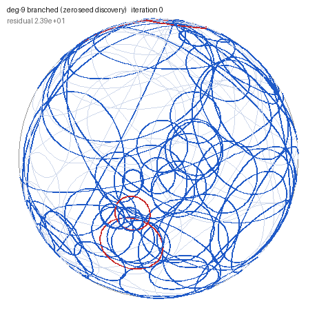

<h1 align="center">Hi, I'm Jim Ashe 👋</h1>

  <b>Mathematician (PhD) and 20-year educator — doing mathematical research, authoring math content, and building AI systems for education.</b>

I author mathematics content in **LaTeX** — full courses, competency-based assessments, standardized-exam items — and build **applied AI for education**: a retrieval-grounded course assistant with human-in-the-loop feedback tooling, and rubric-based quality gates for assessment. The through-line is **measurement**: deciding what counts as correct, then holding both student work and AI outputs to that standard. Published researcher and hands-on builder.

I'm especially interested in **AI-assisted content authoring, assessment design, and evaluation** — always happy to talk shop about math pedagogy or eval methodology.

  
   My schwarzian solver converging to a <b>branched</b> circle packing of the sphere (degree 9). <a href="https://github.com/ashejim/CirclePack/tree/sz-solver-upstream">Code</a>

---

## 🔧 Selected work

| Project | What it is | Focus |
|---|---|---|
| **[Schwarzian circle-packing solver](https://github.com/ashejim/CirclePack/tree/sz-solver-upstream)** *(2026, new)* | A working algorithm that computes circle packings of the sphere, **including branched packings**, from the intrinsic schwarzian coordinates of [Stephenson (arXiv:2503.06334)](https://arxiv.org/abs/2503.06334). Implemented as the `sz` extender in CirclePack (Java), with two companion papers in draft: rigidity/uniqueness/realizability, and a locally convergent packing algorithm. Built in collaboration with Ken Stephenson, using AI-assisted research workflows. | Math research · algorithms · Java · AI-assisted research |
| **[In-browser engineering-AI labs](https://ashejim.github.io/engineering-ai-lab-demo/)** | A proof of concept for running course labs with no installs: a physics-informed neural network (PINN) evaluation lab and a Bayesian-optimization simulation-planning demo, executing entirely in the browser via Jupyter Book + JupyterLite. ([repo](https://github.com/ashejim/engineering-ai-lab-demo)) | PINNs · Bayesian optimization · courseware |
| **[Course FAQ Bot Framework](https://github.com/ashejim/c769-capstone-bot)** | A reusable, config-driven framework for turning *any* course's materials into an evaluated, privacy-safe RAG assistant — with human-in-the-loop feedback tooling. Sanitized case study. | RAG · LLM eval · privacy-by-design |
| **[Math Content Portfolio](https://github.com/ashejim/math-content_portfolio)** | Two decades of authored math content — 9 full university course archives with LaTeX source, recent activity-style practice sets, and **expository talks with animated slide sequences** (Cauchy rigidity, the Art Gallery Theorem, Cantor's infinities). | Content authoring · LaTeX · assessment |
| **[C964 course site](https://github.com/ashejim/C964)** | A live Jupyter Book course site for WGU's CS capstone — task-by-task guidance with complete worked ML examples, used by the students it was built for. | Courseware · teaching |
<!-- Uncomment after pushing the eval-benchmark repo to github.com/ashejim/eval-benchmark:
| **[Math-Reasoning Eval Benchmark](https://github.com/ashejim/eval-benchmark)** | An original benchmark pairing an objective final-answer quality gate with rubric-based partial credit and an LLM-as-judge layer, for grading mathematical reasoning. | LLM eval · benchmarks |
-->
| **[Metric-Validity Counterexamples](https://github.com/ashejim/wgu-metric-counterexamples)** | Monte-Carlo *existence proofs* of how a single aggregate metric can mislead across populations — a literal Simpson's paradox, metric deflation, non-uniform optimal allocation. | Measurement · statistics · evaluation |
| **[CaseloadNotes](https://github.com/ashejim/caseload-tool)** | A Windows desktop app that automates the repetitive Salesforce/Outlook workflow of running a course caseload — batch actions, at-rest encryption, tested, packaged. | Applied software · Python |
| **[CirclePack](https://github.com/ashejim/CirclePack)** *(contributor)* | Open-source research software for circle packing (in the sense of Thurston), tied to my published mathematics; home of the schwarzian solver above. | Math research · Java |

---

## 🎓 Background

- **PhD, Mathematics** — University of Tennessee
- Published in *The Journal of Analysis* · [arXiv:1607.03404](https://arxiv.org/abs/1607.03404) · [Google Scholar](https://scholar.google.com/citations?user=raxuPegAAAAJ)
- 20+ years teaching mathematics, computer science, and data analytics; designed a competency-based performance assessment (with an objective quality gate) for a CI/CD and MLOps course in WGU's Bachelor of Science in AI Infrastructure and Operations, and serve as subject matter expert for a master's-level course in AI for engineering and scientific discovery.

## 📫 Connect

- **LinkedIn:** [james-ashe](https://www.linkedin.com/in/james-ashe-95851a156/)
- **Google Scholar:** [publications](https://scholar.google.com/citations?user=raxuPegAAAAJ)
- **Email:** drjimashe@proton.me
